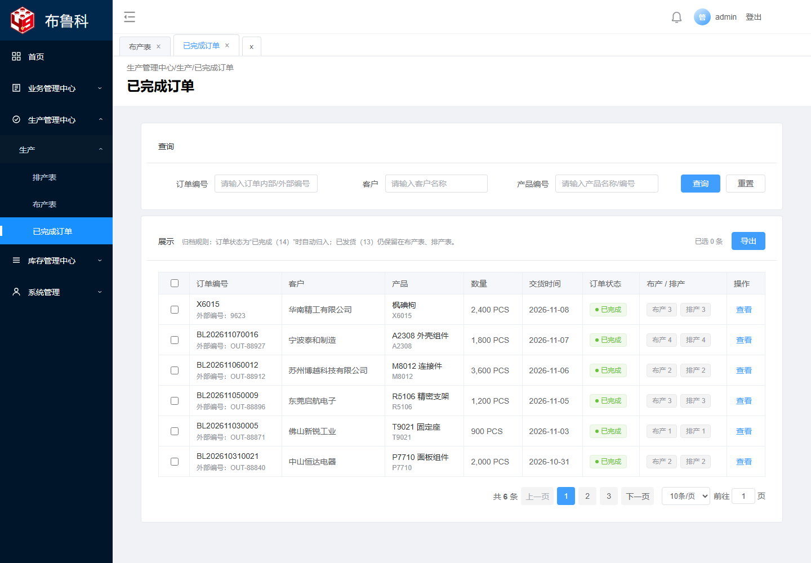
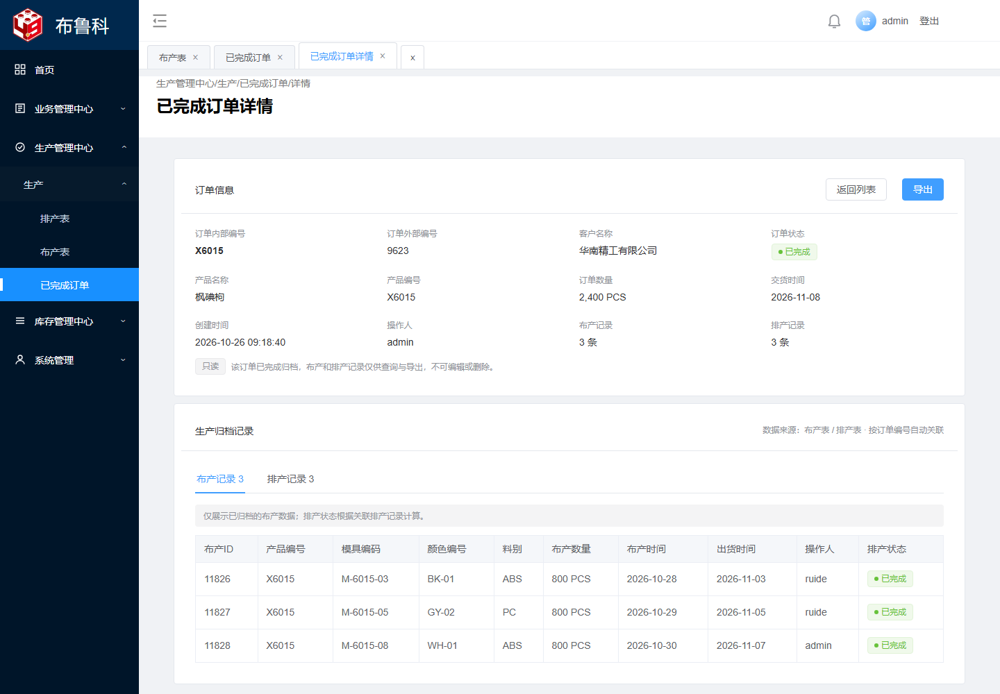

# 已完成订单归档方案与页面原型

> 本文档用于确认“已完成订单”页面的交互、业务口径及后续实现边界。原型数据为演示数据，页面样式基于现有系统 Vue + Element Plus 前端、真实 Logo、左侧三级菜单、顶部页签、查询卡片和表格卡片还原。

## 一、背景与目标

目前布产表、排产表持续保留全部历史记录，随着已完成订单增加，在办数据越来越难以识别。希望新增独立的“已完成订单”入口，让订单完成后的布产、排产数据自动进入归档视图，减少在办列表干扰，同时保留历史查询和导出能力。

### 已确认口径

- 仅订单状态为 **已完成（状态值 14）** 时进入归档。
- **已发货（状态值 13）** 仍保留在布产表、排产表中，不提前归档。
- 采用逻辑归档，不复制布产、排产数据，不新增归档业务表。
- 归档数据只读，只允许查询、查看详情和导出。
- 菜单位置：生产管理中心 → 生产 → 已完成订单。

## 二、页面原型

### 1. 已完成订单列表



列表页保留系统原有布局：

- 左侧为深蓝色三级菜单，新增“已完成订单”菜单项。
- 顶部保留用户信息栏及可关闭页签。
- 页面标题区保留 `生产管理中心/生产/已完成订单` 路径和 24px 加粗标题。
- “查询”卡片沿用现有 3 列字段加右侧按钮布局。
- “展示”卡片沿用现有表格、选择列、导出按钮和分页样式。
- 归档数据不显示编辑、删除等操作，仅保留“查看”。

建议查询条件：

| 条件 | 说明 |
| --- | --- |
| 订单编号 | 支持订单内部编号、外部编号 |
| 客户 | 支持客户名称模糊查询 |
| 产品编号 | 支持产品名称、产品编号查询 |
| 交货时间 | 后续可按日期范围查询，和现有日期筛选组件保持一致 |

建议列表字段：

| 字段 | 说明 |
| --- | --- |
| 订单编号 | 显示内部编号，并在下方显示外部编号 |
| 客户 | 客户名称 |
| 产品 | 产品名称及产品编号 |
| 数量 | 订单数量，单位 PCS |
| 交货时间 | 订单交付日期 |
| 订单状态 | 固定显示“已完成”标签 |
| 布产 / 排产 | 显示关联记录数量 |
| 操作 | 只提供“查看” |

### 2. 已完成订单详情



点击列表中的“查看”后，沿用系统新增页签的方式打开“已完成订单详情”，不采用弹窗。详情页包含：

1. **订单信息卡片**：订单编号、客户、产品、数量、交货时间、状态、创建时间、操作人及关联记录数。
2. **生产归档记录卡片**：通过页签切换“布产记录”和“排产记录”，两个页签分别进行服务端分页，默认每页 10 条，可切换 10/20/50/100 条。
3. **只读提示**：明确归档数据不可编辑、删除。
4. **导出按钮**：导出当前订单的归档信息。

布产记录建议显示：布产 ID、产品编号、模具编码、颜色编号、料别、布产数量、布产时间、出货时间、操作人、排产状态。

布产页签查询条件：出货日期、布产时间、操作人、颜色编号、模具状态、产品编号、供应商、模具编码、模具厂家、料别。

排产记录建议显示：排产 ID、模具编号、颜色编号、料别、出模数、排产数量、排产重量、安排时间、完成时间、操作人。

排产页签查询条件：安排日期、完成时间、操作人、颜色编号、料别、模具编号。

两个页签均支持每页 10/20/50/100 条切换；查询条件由后端参与过滤后再执行分页。

## 三、业务逻辑

### 3.1 数据归属

归档状态直接根据订单实时状态计算，不在布产表或排产表增加独立归档状态。

- 布产表通过 `erp_production_schedule.order_code = erp_orders.inner_id` 关联订单。
- 排产表通过 `erp_production_schedule.arrange_id = erp_production_arrange.id` 关联布产记录，再定位订单。
- 原布产表、排产表查询排除已完成订单。
- 已完成订单页只查询已完成订单对应的布产、排产记录。
- 历史已完成订单发布后自动出现在归档页，无需手工迁移。
- 若订单状态回退，记录自动返回原布产表、排产表，并从归档页消失。

### 3.2 多订单关联规则

一条排产记录可能关联多条布产、多个订单。此时：

- 只有全部关联订单均为“已完成”时，该排产记录才进入归档。
- 只要存在一个未完成订单，该排产记录仍保留在排产表，避免隐藏仍在生产中的数据。

### 3.3 状态边界

| 状态 | 状态值 | 布产表/排产表 | 已完成订单 |
| --- | ---: | --- | --- |
| 已发货 | 13 | 保留 | 不显示 |
| 已完成 | 14 | 隐藏 | 显示 |
| 回退到未完成状态 | < 14 | 恢复显示 | 隐藏 |

“完成布产”仅表示布产计划制定完成，不等同于订单完成；“排产完成时间”也只代表生产环节完成，归档判断必须使用订单状态。

## 四、接口设计与实施

已新增以下只读接口，避免复用可编辑接口产生误操作：

| 接口 | 用途 |
| --- | --- |
| `GET /system/production-archive/orders` | 分页查询已完成订单 |
| `GET /system/production-archive/{orderCode}/schedules` | 分页查询订单关联的布产归档记录 |
| `GET /system/production-archive/{orderCode}/arranges` | 分页查询订单关联的排产归档记录 |
| `POST /system/production-archive/export` | 导出已完成订单或明细 |

原列表接口已调整：

- 布产列表增加“排除已完成订单”条件。
- 排产列表改为自定义联表查询，排除关联订单已全部完成的排产记录。
- 现有新增、编辑、删除和导入接口的行为不变。

## 五、性能与数据一致性

- 不复制业务数据，订单状态是唯一归档依据，避免归档表与业务表双写不一致。
- 已提供 `sql/erp_production_archive_indexes.sql`，为 `erp_orders.status`、`erp_production_schedule.order_code`、`erp_production_schedule.arrange_id` 增加索引。
- 归档页查询应使用数据库分页，不在前端二次过滤。
- 一个排产关联多订单时，使用“全部完成才归档”的聚合判断。
- 归档页为只读接口，不暴露编辑、删除、批量修改能力。

## 六、验收场景

1. 订单状态由其他状态变更为“已完成”后，布产和排产记录立即从原列表消失，并出现在已完成订单页。
2. 订单状态为“已发货”时，记录仍保留在原列表。
3. 已完成订单详情可切换查看布产记录和排产记录。
4. 已完成订单页面不存在编辑、删除入口。
5. 勾选订单后可导出，未选择时给出提示。
6. 订单状态回退后，归档记录自动回到原列表。
7. 一条排产关联多个订单时，只有全部订单完成才归档。
8. 历史已完成订单无需人工迁移即可在归档页查询。

## 七、原型文件

- 可交互原型：`doc/prototypes/completed-orders-prototype.html`
- 列表截图：`doc/images/completed-orders-overview.png`
- 详情截图：`doc/images/completed-orders-detail.png`

直接用浏览器打开 HTML 即可演示筛选、查看详情、页签切换和导出提示。原型使用系统真实 Logo、现有主样式和 Element Plus 默认样式，确保视觉风格与当前前端一致。
## 九、自动化测试

测试文件：`ruoyi-admin/src/test/java/com/ruoyi/web/service/impl/CompletedOrderArchiveIntegrationTest.java`

测试直接读取现有 `application-test-db.yml`，仅执行只读查询，不启动完整应用、定时任务和通知。覆盖内容：

- 已完成订单详情的布产、排产服务端分页。
- 每页数量限制、总数计算和按模具编号筛选。
- 布产表、排产表默认排除已完成订单。
- 未完成订单禁止访问归档详情。
- 已完成订单菜单和归档索引已写入测试库。

执行命令：

```bash
mvn -pl ruoyi-admin -am "-Dtest=CompletedOrderArchiveIntegrationTest" "-Dsurefire.failIfNoSpecifiedTests=false" test
```